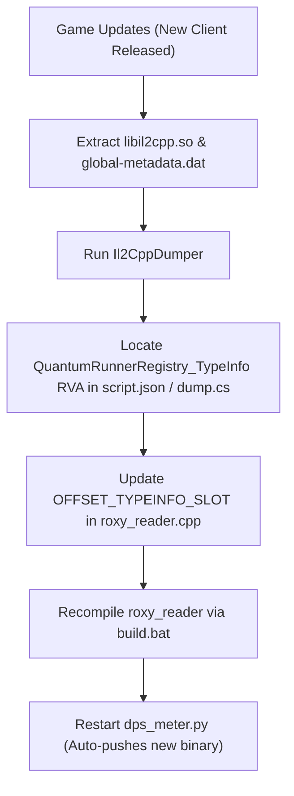

# RoxyDPS - CoopTD Damage Meter & External Memory Monitor
## Complete User Manual & Maintenance Guide

---

## Table of Contents
1. [Overview & Core Architecture](#1-overview--core-architecture)
2. [Critical Root & Anti-Cheat Setup](#2-critical-root--anti-cheat-setup)
3. [Prerequisites](#3-prerequisites)
4. [Building the Native Reader (`roxy_reader`)](#4-building-the-native-reader-roxy_reader)
5. [Running the Python Desktop Overlay (`dps_meter.py`)](#5-running-the-python-desktop-overlay-dps_meterpy)
6. [GUI Features & Controls](#6-gui-features--controls)
7. [Combat Simulation & Damage Formulas](#7-combat-simulation--damage-formulas)
8. [Maintenance Guide: Game Updates & RVA Maintenance](#8-maintenance-guide-game-updates--rva-maintenance)
9. [Troubleshooting & FAQ](#9-troubleshooting--faq)

---

## 1. Overview & Core Architecture

**RoxyDPS** is an external, read-only Damage & DPS meter designed for *CoopTD / Lucky Defense* (`cooptd`) running on Android emulators (e.g., MuMu Player 12, LDPlayer).

Unlike traditional game monitoring tools that inject code via LSPosed, Frida, or Zygisk, **RoxyDPS uses a 100% external memory reading architecture**:
* **Zero Process Injection**: The game process (`cooptd`) is never touched, modified, or hooked.
* **Zero Memory Protection Alteration**: Memory permissions (`PROT_WRITE`, `PROT_EXEC`) remain untouched, bypassing runtime checksum and integrity checks.
* **Kernel Syscall (`process_vm_readv`)**: A standalone C++ ELF executable (`roxy_reader`) runs as root outside the game process, streaming combat events to a Python Tkinter overlay over ADB pipes.

```text
+-------------------------------------------------------------+
|                     Windows PC (Host)                       |
|                                                             |
|   +-----------------------------------------------------+   |
|   |             Python GUI (dps_meter.py)               |   |
|   |  - Floating Always-on-Top overlay (Tkinter)         |   |
|   |  - Real-time Tower Rankings, Self vs Teammate       |   |
|   |  - Controls: Reset Stats, Auto-Reset Toggle         |   |
|   +--------------------------^--------------------------+   |
|                              | JSON stream over ADB         |
+------------------------------|------------------------------+
                               |
                        [ ADB Tunnel ]
                               |
+------------------------------v------------------------------+
|                Android Emulator (MuMu 12 / LDPlayer)        |
|                                                             |
|   +-----------------------------------------------------+   |
|   |     External Native Reader (/data/local/tmp/...)    |   |
|   |  - Standalone root executable (Zero injection)      |   |
|   |  - High-frequency polling via process_vm_readv()    |   |
|   |  - Deterministic HitKey deduplication               |   |
|   +--------------------------^--------------------------+   |
|                              | process_vm_readv             |
|                              | (Kernel Read-Only)           |
|   +--------------------------v--------------------------+   |
|   |               Game Process (cooptd)                 |   |
|   |  - 100% Untouched, NO LSPosed, NO Hooks, NO Mod     |   |
|   +-----------------------------------------------------+   |
+-------------------------------------------------------------+
```

---

## 2. Critical Root & Anti-Cheat Setup

> [!IMPORTANT]
> **DO NOT turn ON the "Root" switch in your emulator settings!**

### Why does the game close if Emulator Root is ON?
1. Enabling "Root" in MuMu Player or LDPlayer settings places `/system/xbin/su` inside the Android system image.
2. The game's anti-cheat scans for `/system/xbin/su`, `/system/bin/su`, and known root binaries. If detected, the game **force-closes after 5–10 seconds**.

### The Proper Method: `adb root`
Leave the emulator's Root toggle **OFF**. RoxyDPS connects through ADB and executes `adb root`:
* `adbd` (the ADB daemon) is promoted to `uid=0(root)` and SELinux domain `u:r:su:s0`.
* The Android system partition remains completely pristine without any `/system/xbin/su` binaries.
* The game's anti-cheat sees zero root artifacts and will **never crash**.
* `roxy_reader` executes with full UID 0 privileges, allowing unrestricted `process_vm_readv` access to process memory.

---

## 3. Prerequisites

1. **Android Emulator**:
   * **MuMu Player 12** (Recommended, default port: `127.0.0.1:16384`) or **LDPlayer 9** (port: `127.0.0.1:5555`).
   * Turn **OFF** root permission in emulator settings.
2. **Android Platform Tools (ADB)**:
   * Ensure `adb.exe` is available (e.g., in `platform-tools` or added to system `PATH`).
3. **Python 3.8+**:
   * Requires standard Python with Tkinter (`tcl/tk` support).
4. **Android NDK (for building `roxy_reader`)**:
   * Installed via Android Studio (`SDK Manager -> SDK Tools -> NDK (Side by side)`), or standalone NDK folder (r23b+ recommended).

---

## 4. Building the Native Reader (`roxy_reader`)

Whenever you modify `roxy_reader.cpp` (or after updating RVAs following a game update), compile the binary using `build.py`:

### Standard Build (Auto-Detect NDK)
Run from command prompt in `C:\Users\user\Desktop\gemi\20261026`:
```cmd
python build.py
```
`build.py` automatically detects Android NDK installations on your system (checking standard Android Studio SDK directories, environment variables, and common drive paths). It builds both `arm64-v8a` and `x86_64` ELF binaries and automatically copies the binary to `roxy_reader`.

### Custom NDK Path
If your NDK is installed in a specific custom location:
```cmd
python build.py C:\path\to\your\ndk_folder
```

### Windows Shortcut
You can also simply double-click `build.bat` (which delegates directly to `python build.py`).

---

## 5. Running the Python Desktop Overlay (`dps_meter.py`)

1. Start your emulator (MuMu Player 12) and wait until Android finishes booting.
2. Launch the overlay:
   ```cmd
   python dps_meter.py
   ```
3. Click **"Start Monitor"**:
   * The program automatically locates ADB, tests connection to emulator ports (`16384`, `7555`, `5555`), promotes ADB to root (`adb root`), pushes `roxy_reader` to `/data/local/tmp/`, and starts monitoring.
4. Launch the game (*CoopTD*):
   * `roxy_reader` scans memory segments for the 60MB executable IL2CPP block.
   * The status bar will turn green:
     `🟢 Attached (com.percent.aos.cooptd | PID 12345)`
5. Enter a Co-op battle:
   * Real-time damage rankings, player identification (`[Self]` vs `[Teammate]`), and hits will populate live.

---

## 6. GUI Features & Controls

| Component | Description |
| :--- | :--- |
| **Status Indicator** | Displays current reader state: `🔴 Offline`, `🔍 Searching Game`, `🟢 Attached`, `⚔️ In Battle`, or `🏠 In Lobby`. |
| **Start / Stop Monitor** | Starts or terminates the background ADB process and reader daemon. |
| **Reset Stats** | Instantly clears all damage counters, hit lists, and charts on both the Python GUI and inside `roxy_reader`. |
| **Clear Log** | Clears the live visual GUI console box without affecting the disk log. |
| **Open Log File** | Opens the complete, un-truncated persistent log file (`dps_debug.log`) in Notepad for debugging. |
| **Auto-Reset (New Match)** | **Checked (Default)**: Automatically wipes stats when exiting to lobby and starting a new match.<br>**Unchecked (Manual Mode)**: Damage numbers accumulate continuously across multiple consecutive matches until manually reset. |
| **Always on Top** | Keeps the DPS meter pinned above the emulator window while playing. |
| **Team Ratio Bar** | Dynamic colored bar displaying Self (Green) vs. Teammate (Cyan) damage distribution. |
| **Tower Ranking Table** | Columns: `Player`, `Unit Name` (e.g. `Dragon_Lv1_A`), `Total Dmg`, `Share %`, `Hits`, `Crits`, `Last Dmg`, and `Entity Handle`. |

---

## 7. Combat Simulation & Damage Formulas

### Exact Damage Divisor & `x.xxx` Unit Notation
Photon Quantum uses fixed-point integers internally for deterministic calculations across different architectures:
$$\text{Display Damage} = \frac{\text{Raw Integer Damage}}{10000.0}$$
* Example: Raw value `2050000` $\rightarrow$ Display `205.000`.
* Critical hits (raw value $> 2,500,000$, display $> 250.000$) are flagged with `(CRIT!)` and tallied in the Crits column.

Damage values across the entire UI are formatted to 3 decimal places (`x.xxx`) with standard tier unit suffixes:

| Tier Range | Suffix Unit | Multiplier | Example Output |
| :--- | :--- | :--- | :--- |
| $< 1,000$ | *(None / 無)* | $10^0$ | `543.210` |
| $\ge 1,000$ | **K** | $10^3$ | `12.345 K` |
| $\ge 1,000,000$ | **M** | $10^6$ | `1.235 M` |
| $\ge 1,000,000,000$ | **B** | $10^9$ | `5.679 B` |
| $\ge 10^{12}$ | **T** | $10^{12}$ | `34.560 T` |
| $\ge 10^{15}$ | **Qa** (Quadrillion) | $10^{15}$ | `6.780 Qa` |
| $\ge 10^{18}$ | **Qi** (Quintillion) | $10^{18}$ | `8.900 Qi` |

### Prediction Rollbacks & Hit Deduplication
Photon Quantum ECS runs client-side prediction ahead of the server. When late server input packets arrive, the engine rewinds simulation ticks backwards (e.g., from Tick 1250 back to 1220) and re-simulates forward.

To prevent rollbacks from wiping stats or duplicating hit damage:
* RoxyDPS uses a deterministic signature:
  $$\text{HitKey} = \{\text{tick}, \text{tower\_idx}, \text{enemy\_idx}, \text{damage\_raw}\}$$
* When re-simulated ticks are processed, previously seen hits are recognized and cleanly skipped.
* Ticks rewinding mid-match will **never** reset statistics.

---

## 8. Maintenance Guide: Game Updates & RVA Maintenance

### Will RVAs change when the game updates?
> [!WARNING]
> **YES. Almost every game update alters the IL2CPP memory layout.**

When the game developers release a new update, Unity recompiles all C# code into a brand new `libil2cpp.so`. As a consequence:
1. All function RVAs change.
2. The global TypeInfo pointer table (located in the `.bss` / `.data` segments) is reshuffled.
3. Therefore, `#define OFFSET_TYPEINFO_SLOT` **must be updated for each new client version**.

---

### Step-by-Step Maintenance Workflow



#### Step 1: Extract `libil2cpp.so` and `global-metadata.dat`
From your emulator or updated APK:
* Pull the 64-bit library:
  ```cmd
  adb shell "su -c 'cp /data/app/*cooptd*/lib/arm64/libil2cpp.so /data/local/tmp/'"
  adb pull /data/local/tmp/libil2cpp.so .
  ```
* Pull the metadata file:
  ```cmd
  adb shell "su -c 'cp /data/app/*cooptd*/base.apk /data/local/tmp/'"
  adb pull /data/local/tmp/base.apk .
  ```
  *(Unzip `base.apk` to extract `assets/bin/Data/Managed/Metadata/global-metadata.dat`)*

#### Step 2: Run Il2CppDumper
1. Launch **Il2CppDumper.exe**.
2. Select `libil2cpp.so` (Executable file).
3. Select `global-metadata.dat` (Metadata file).
4. Il2CppDumper will generate `dump.cs` and `script.json`.

#### Step 3: Find the New RVA for `QuantumRunnerRegistry`
Open `script.json` in a text editor (or use VS Code / Notepad++) and search for:
```text
QuantumRunnerRegistry_TypeInfo
```
You will find an entry resembling:
```json
{
  "Address": 217381648,
  "Name": "QuantumRunnerRegistry_TypeInfo",
  "Signature": "Quantum_QuantumRunnerRegistry_c*"
}
```
Convert the decimal `Address` to hexadecimal:
$$\text{Address } 217381648 \rightarrow \mathtt{0xCF4FB10}$$

Alternatively, open `dump.cs` and search for:
```csharp
// Namespace: Quantum
public class QuantumRunnerRegistry
```
Find references in methods accessing `QuantumRunnerRegistry.Global` or check the TypeInfo table.

#### Step 4: Verify Component Field Offsets
Check in `dump.cs` to confirm if component field offsets have changed:
* **`QuantumRunnerRegistry`**:
  * `_activeRunners`: usually offset `+0x10`.
* **`Tower` component struct**:
  * `UnitId`: offset `+0x14`
  * `PlayerRef`: offset `+0x20`
  * `myEntity`: offset `+0x68`
* **`EventOnHitBullet`**:
  * Verify event ID (typically `24` / `0x18`).

#### Step 5: Update `roxy_reader.cpp`
Open `roxy_reader.cpp` and update line 24 with the new RVA:
```cpp
// ==========================================
// 📍 Verified Offsets & RVAs (Updated for vX.X.X)
// ==========================================
#define OFFSET_TYPEINFO_SLOT     0xCF4FB10 // Update with new hexadecimal RVA
#define OFFSET_STATIC_FIELDS     0xb8      // Il2CppClass -> static_fields (Standard Il2Cpp)
#define EVENT_ID_HIT_BULLET      24        // EventOnHitBullet ID
```

#### Step 6: Recompile with `build.py`
Run:
```cmd
python build.py
```
*(Or specify custom NDK path: `python build.py C:\path\to\your\ndk`)*

The new `roxy_reader` binary is immediately ready. When you click **"Start Monitor"** in `dps_meter.py`, it automatically pushes the updated binary to the emulator.

---

## 9. Troubleshooting & FAQ

### Q1: The monitor attached to an emulator PID (`nemu`) or kept jumping between Attached and Offline.
* **Explanation**: In MuMu Player 12, internal hypervisor and graphics translation services are named `nemu` / `com.netease.nemu`.
* **Fix**: `roxy_reader` now strictly excludes `nemu`, `mumu`, `netease`, `luckydefense`, and emulator driver mappings (`/system/`, `/vendor/`, `/apex/`), locking exclusively onto `com.percent.aos.cooptd`. In addition, waiting at the title screen/lobby no longer triggers consecutive read failure timeouts, so the reader stays solidly attached without jumping.

### Q2: The log says `Searching 60MB Code / il2cpp... Inspected 157 apps` and won't attach.
* **Solution**: Ensure the game (*CoopTD*, package `com.percent.aos.cooptd`) is running and past the initial publisher logo. The reader prioritizes processes with `cooptd` or `percent` in their package name and attaches as soon as the 60MB code segment is mapped.

### Q3: Game force-closes 5 to 10 seconds after opening.
* **Cause**: Emulator settings "Root" is turned ON, creating `/system/xbin/su`.
* **Solution**: Open emulator settings, toggle **Root OFF**, restart the emulator, and let `dps_meter.py` manage `adb root`.

### Q4: Total damage suddenly reset to zero mid-battle.
* **Solution**: You may have clicked "Reset Stats". Under normal conditions, tick rollbacks do not cause resets. If you desire total damage to persist even across multiple matches, uncheck the **"Auto-Reset (New Match)"** box.

### Q5: Tkinter GUI freezes or drops frames during intense combat.
* **Solution**: `dps_meter.py` caps the console log to the latest 150 lines and updates the ranking table on 1-second summary ticks. If you have been running for hours, click **"Clear Log"** to free GUI buffer memory.
